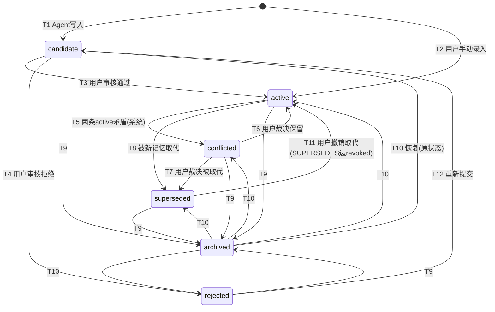

# 记忆状态机（已决议 — ADR-003，已实现于 src/ame/domain/state_machine.py）

状态：candidate / active / conflicted / superseded / archived / rejected。
所有转换：Application Service 校验规则与操作者 → 写状态 → 同一事务写入 `memory_audit_events`
（event_type、from_value、to_value、trigger=规则编号、actor_type、actor_id、reason、created_at）。
reason 对所有手动转换必填；系统转换由系统写入原因。

## 状态含义
| 状态 | 含义 |
|---|---|
| candidate | 待审核：Agent 写入，尚未经用户确认 |
| active | 有效：可正常检索使用 |
| conflicted | 有矛盾：与另一条 active 记忆存在 CONTRADICTS，待用户裁决；搜索默认隐藏 |
| superseded | 已被取代：被另一条记忆取代（存在 SUPERSEDES 新→旧 结构边） |
| archived | 已归档：不再使用，不物理删除，可恢复 |
| rejected | 已拒绝：审核未通过，保留记录 |

## 初始状态
| 规则 | 结果 | 操作者 | 条件 |
|---|---|---|---|
| T1 | candidate | agent / system | 默认写入（禁止自动晋升） |
| T2 | active | user | 用户本人手动录入（S1 已决议） |

## 合法转换
| 规则 | 从 | 到 | 操作者 | 触发条件 |
|---|---|---|---|---|
| T3 | candidate | active | user | 用户审核通过（S5：仅用户本人可审核） |
| T4 | candidate | rejected | user | 用户审核拒绝 |
| T5 | active | conflicted | system | 两条 active 记忆之间创建 CONTRADICTS 关系时，双方自动转换 |
| T6 | conflicted | active | user | 用户裁决保留 |
| T7 | conflicted | superseded | user | 用户裁决由另一条取代；必须给出 superseded_by_memory_id，自动建 SUPERSEDES 边 |
| T8 | active | superseded | user / agent | 显式被另一条记忆取代；同上建 SUPERSEDES 边（经环检测） |
| T9 | candidate/active/conflicted/superseded/rejected | archived | user / agent | 归档（不物理删除） |
| T10 | archived | 归档前状态 | user | 恢复；目标必须等于审计中记录的归档前状态 |
| T11 | superseded | active | user | 用户撤销取代（S3 已决议）；SUPERSEDES 边标记 revoked 并保留（ADR-006） |
| T12 | rejected | candidate | user / agent | 重新提交审核（S4 已决议） |

非转换事件：创建新正文版本不改变状态（审计 version_created）；修改 layer/memory_type 不改变状态（审计 classification_changed）。

## 禁止的转换（返回 409 INVALID_STATUS_TRANSITION，或操作者不符返回 403 TRANSITION_NOT_PERMITTED）
- 上表以外的任意 (from, to) 组合，包括同状态“转换”。
- agent/system 执行 T3/T4/T6/T7/T10/T11（禁止自我晋升、自我裁决）。
- candidate 与 active 矛盾时不改状态，只记录 CONTRADICTS 关系并返回 review_notice 提醒用户（S2 已决议）。
- 物理删除（彻底删除流程待 Q9）。
- 覆盖历史版本或审计记录（数据库触发器拒绝）。

## 修订（ADR-006 / ADR-009，2026-11-02 Asia/Shanghai）
- T11（superseded → active，user）：同一事务内将指向该记忆的所有 active SUPERSEDES 边标记为 revoked（revoked_at、revoked_by、revoked_actor_type、revoked_reason = 本次转换的 actor 与 reason），原边保留可查。此前“SUPERSEDES 边保留作历史追溯”的含义更新为“保留但 revoked”。
- 之后再次 T8/T7 取代会创建新的 SUPERSEDES 边（新 edge_id）。
- SUPERSEDES 边不能通过通用撤销接口撤销，只能经 T11。
- ADR-009：archived 状态下禁止 create_version（Service 返回 MEMORY_ARCHIVED，数据库触发器同样拒绝）；须先 T10 restore（审计记录 actor_type、actor_id、created_at、reason），恢复后按正常规则操作。
- T5 只由 CONTRADICTS 触发；SUPPORTS / RELATED_TO 不改变状态。撤销 CONTRADICTS 不会自动把 conflicted 改回 active（仍需用户 T6/T7 裁决）。
